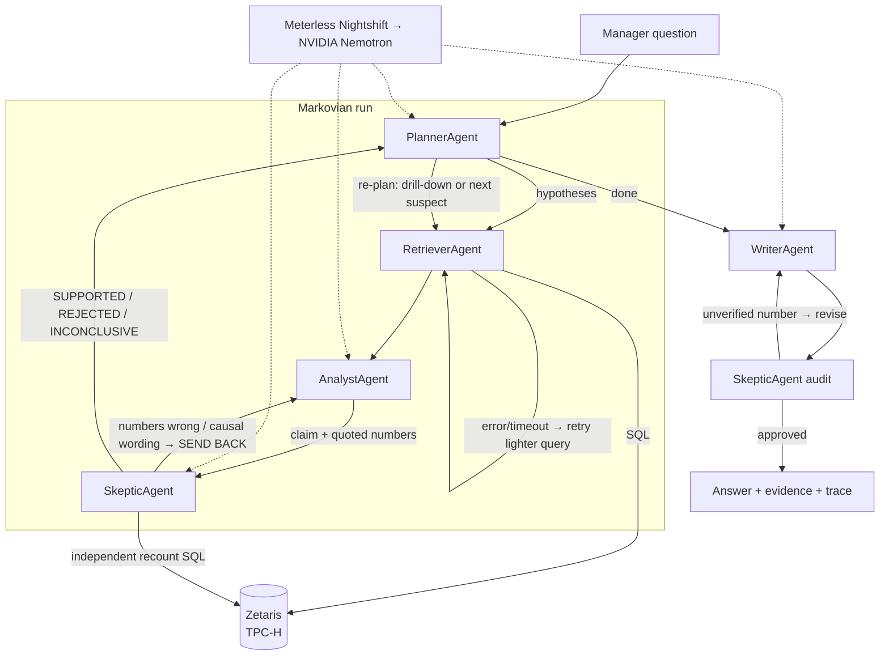

# Late Shipment Detective

> **Track:** The Agent That Can Explain Why · **Open Agent Hackathon 2026**
> **Sponsor tech:** Zetaris (data layer) · Meterless Markovian engine · Meterless Nightshift (AI provider) · NVIDIA Nemotron
> **Run:** `npm run investigate -- --input input_examples/example_1.json` or `npm run serve` → `POST /run`

## 1. Problem

An operations or procurement manager sees deliveries arriving after the committed date and has to decide what to fix:
switch carriers? drop suppliers in a region? prioritise urgent orders? The usual suspects are easy to blame
and expensive to act on. Checking each one means pulling order, line-item, supplier and geography data together
and doing the analysis by hand.

**Late Shipment Detective** answers *"why are our shipments late?"* with an evidence-backed explanation:
which factors really are associated with lateness, **which suspects the data rules out**, and what to do next.
Every number in the answer has been recounted by a second agent directly against the data.

## 2. Agents

| Agent | Responsibility | Can block / send back? |
|---|---|---|
| `PlannerAgent` | Turns the question into testable hypotheses from a fixed catalog; re-plans after every verdict (adds drill-downs, drops what is answered). Reads only the Markovian carryover. | Decides what runs next |
| `RetrieverAgent` | Queries Zetaris for the late-rate breakdown of one factor. On error/timeout retries with a lighter query (recent orders only). | Escalates to Planner when data is unavailable |
| `AnalystAgent` | Reads the breakdown and states one claim with the numbers it relies on. | – |
| `SkepticAgent` | Runs its **own** queries through Zetaris (baseline + recount of every bucket the Analyst quoted), tests effect size and significance (χ²), challenges causal wording, and audits every number in the final report. | **Yes** – sends claims back, rejects suspects, blocks the report |
| `WriterAgent` | Writes the manager-facing explanation from verified evidence only. | Revises when the Skeptic's audit fails |

## 3. What makes this an agent system (not a chain)



* **Critique loop:** the Skeptic recounts what the Analyst quoted and sends the claim back if a number is wrong or the wording claims causation.
* **Rejection authority:** suspects with no meaningful difference (< 5 pp between best and worst group, or not significant at p < 0.001) are **ruled out**, and the answer says so.
* **Dynamic re-planning:** after each verdict the Planner decides the next test, e.g. a drill-down such as `ship_mode@dispatch_lag=91d+`.
* **Retry and fallback:** failed Zetaris queries are retried with a lighter query, and a factor whose data stays unavailable is marked inconclusive instead of guessed.
* **Report audit:** every percentage in the final answer must match verified evidence, or the Writer revises.
* **Traces:** every action and hand-off is written to `logs/<trace_id>.jsonl` and printed to stdout, with the model that handled each call.

## 4. Sponsor technology

**Zetaris (data layer).** All data access goes through the Zetaris REST API (`src/adapters/zetaris.ts`): the Retriever's
breakdowns, the Skeptic's independent recounts, and the baseline. The data is TPC-H (orders, line items, suppliers, nations, regions), generated with DuckDB's
`dbgen` and registered in Zetaris as Parquet filestore tables by `npm run load-tpch`, since the local platform bundle seeds only
`NY_TAXI` and `TPCDS_DB`. TPC-DS was checked and not used: its ship lag is uniform (about 33.6% "late" in every ship mode,
warehouse, call center and year), so it has no cause to find. The SQL is generated from a fixed hypothesis catalog (`src/analysis.ts`)
in Zetaris Lightning (Spark) SQL. Remove Zetaris and the agents have nothing to reason over.

**Meterless engine: Markovian.** `src/engines/markovian/` is our own implementation of the Meterless Markovian spec.
The **entire investigation is one Markovian run**: chunk 1 plans, each later chunk tests one hypothesis, and the last chunk
writes and audits the answer. Between chunks only the canonical carryover block passes forward:

```
COMPLETED: ship_mode=REJECTED(4.1pp), dispatch_lag=SUPPORTED(90.1pp)
REMAINING: transit_time, commit_window
DECISIONS: scope {"region":"ASIA"}; baseline 63.9% late of 4587 line items
CONTEXT: question: Why are so many shipments from our ASIA suppliers ...
```

The Planner re-plans from this block alone, so its context stays flat (≈200 tokens) however many hypotheses are tested,
while re-reading the full history grows every step (see `markovian.context_per_step` in any output).
**Test:** `npm run test:markovian` runs the **official Meterless conformance suite** against our implementation, and it passes 8/8.

**Meterless Nightshift (primary AI provider).** Every agent model call goes to the Nightshift Runtime
(`src/adapters/nightshift.ts`: OpenAI-compatible `/v1/chat/completions`, `Authorization`, `meterless-app`, `meterless-scope: user`,
status via `/v1/models`: online / unauthorized / offline). `METERLESS_MODEL` picks the routing mode or a concrete model;
`METERLESS_DEEP_MODEL` optionally gives the Skeptic and Writer a deeper lane.

**NVIDIA.** NVIDIA Nemotron models are connected in Nightshift's Providers tab (the NVIDIA key never touches this repo).
The `model` field of every trace event shows which Nemotron model handled each request.

**What is unique.** The Skeptic does not trust the Analyst. It queries Zetaris itself before anything is approved, and its
most valuable output is often a *rejection*: telling a manager which popular explanation is **not** supported by the data.

## 5. Setup

Requirements: Node.js 20.6+ (22 recommended). For live mode: Zetaris running locally (Participant Setup Guide) and Meterless Nightshift running with NVIDIA connected.

```bash
npm install
cp .env.example .env          # fill in ZETARIS_API_KEY and METERLESS_RUNTIME_TOKEN; never commit .env
npm run load-tpch -- --platform <path to zetaris-platform> [--sf 0.2]   # TPC-H -> Zetaris database TPCH
npm run discover              # finds the TPC-H table prefix in Zetaris -> set ZETARIS_TABLE_PREFIX (TPCH.)
npm run check                 # verifies Zetaris + Nightshift (shows which model answered)
```

**No credentials?** `SAMPLE_MODE=true LLM_OFFLINE=true npm run investigate -- --input input_examples/example_1.json`
runs the full agent loop on a generated TPC-H-shaped sample with deterministic fallbacks. Windows PowerShell: set the variables in `.env` instead.

## 6. Usage

```bash
npm run investigate -- --input input_examples/example_1.json --out output_examples/example_1_output.json
npm run investigate -- "Why are deliveries from JAPAN late in 1997?"
npm run serve
curl -X POST http://localhost:8000/run -H "Content-Type: application/json" -d @input_examples/example_2.json
```

Request: `{"question": "...", "filters": {"region"?: "ASIA", "nation"?: "GERMANY", "yearFrom"?: 1996, "yearTo"?: 1997}}`

Response (abridged):

```json
{
  "trace_id": "run_...",
  "answer": {
    "summary": "...",
    "supported":   [{ "factor": "dispatch_lag", "buckets": [...], "skeptic": "90.1 pp gap, p=..." }],
    "ruled_out":   [{ "factor": "ship_mode", "skeptic": "only 4.1 pp between best and worst bucket" }],
    "inconclusive": [],
    "recommended_actions": ["..."],
    "limitations": ["Findings show association, not proven causation."]
  },
  "collaboration": { "skeptic_send_backs": 1, "skeptic_rejections": 2, "retries": 0 },
  "markovian": { "chunks": 6, "final_carryover": "COMPLETED: ...", "context_per_step": [...] },
  "models_used": ["<nemotron model id>"],
  "log_path": "logs/run_....jsonl"
}
```

Examples: `input_examples/` (3 inputs) and `output_examples/` (real outputs saved after runs; `npm run examples` regenerates them and they are never read at run time).

## 7. Tests

```bash
npm run test:markovian   # official Meterless Markovian conformance suite → 8/8
npm test                 # stats, Skeptic misquote detection, end-to-end collaboration + log checks
```

## 8. Failure handling

| Failure | Behaviour |
|---|---|
| Zetaris query error / timeout | Retriever retries with a lighter query (orders from 1997 on); if still failing the factor is marked inconclusive and the Planner continues |
| Nightshift unavailable or bad JSON | One retry, then a deterministic fallback for that agent, logged as `offline-fallback` |
| Analyst misquotes a number | Skeptic sends the claim back with the correct recount (max 2 rounds) |
| Report contains an unverified number | Skeptic sends the draft back to the Writer once |
| Unknown region / nation / hypothesis | Ignored by validation; only catalog values reach SQL |

## 9. Limitations

* Findings show association, not proven causation.
* TPC-H is a synthetic benchmark dataset, so the "real" root cause it reveals is a property of how the data was generated. The agent behaves the same on real data registered in Zetaris.
* Hypotheses come from a fixed catalog of nine factors (keeps SQL valid and safe). New factors need one catalog entry.
* English questions only.

## 10. Pre-existing components

None. All code was written during the build window. Dependencies: `sql.js`, `tsx`, TypeScript. `tests/conformance/runner.ts` is the official Meterless conformance suite (Apache-2.0), vendored unchanged.

## Demo video

Demo video: _add link_
